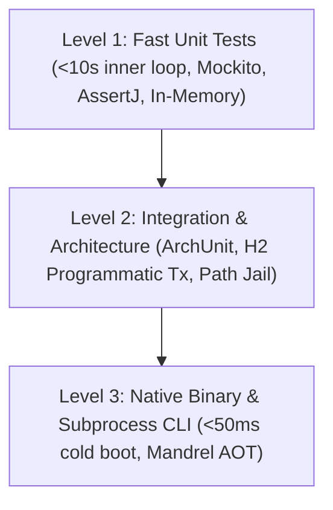

# dev-agent Test Architecture & Engineering Standards

> **Master Reference:** Consult [PROJECT_CONTEXT.md](file:///home/developer/projects/dev-agent/PROJECT_CONTEXT.md), [01-architecture-invariants.md](file:///home/developer/projects/dev-agent/.agents/rules/01-architecture-invariants.md), [02-coding-standards.md](file:///home/developer/projects/dev-agent/.agents/rules/02-coding-standards.md), and [03-quality-and-slas.md](file:///home/developer/projects/dev-agent/.agents/rules/03-quality-and-slas.md).

---

## 1. Testing Pyramid & Multi-Tier Strategy

Every component in `dev-agent` must be tested across a structured 3-tier pyramid. Tests must be fast, isolated, and deterministic.



### Level 1: Fast Unit & In-Memory Tests ($< 10\text{ s}$)
* **Scope:** Individual classes, validators, parsers, cognitive memory stores, and domain SPI implementations.
* **Execution:** Fast inner-loop Maven execution: `./mvnw test -Dtest=*Test`.
* **Mocks:** Use Mockito (`@Mock`, `mock(...)`) or lightweight in-memory stubs for external boundaries.
* **1-to-1 Mapping:** Every production class in `src/main/java` MUST have a dedicated test class in `src/test/java` matching the exact package structure and named `<TargetClassName>Test.java`.

### Level 2: Component Integration & Architecture Governance ($< 15\text{ s}$)
* **Scope:** Architecture invariant checks ([`AgentArchitectureTest`](file:///home/developer/projects/dev-agent/src/test/java/org/quarkus/agent/AgentArchitectureTest.java)), filesystem sandbox boundary checks ([`WorkspaceJailValidatorTest`](file:///home/developer/projects/dev-agent/src/test/java/org/quarkus/agent/workspace/WorkspaceJailValidatorTest.java)), and in-memory H2 database persistence ([`StatePersistenceIT`](file:///home/developer/projects/dev-agent/src/test/java/org/quarkus/agent/entity/StatePersistenceIT.java)).
* **Execution:** Executed via Surefire or Failsafe: `./mvnw test -Dtest=*IT,AgentArchitectureTest`.
* **Programmatic Isolation:** Integration tests requiring Hibernate or Panache operations must use programmatic transaction boundaries (`QuarkusTransaction.requiringNew()`) to prevent session pollution.

### Level 3: Native Executable & Subprocess CLI Tests
* **Scope:** Verifies the Ahead-of-Time (AOT) GraalVM Mandrel native binary (`~/.local/bin/dev-agent`).
* **SLA Verification:** Asserts $< 50\text{ ms}$ cold start boot latency and confirms reflection metadata (`@RegisterForReflection`) works in native images without `ClassNotFoundException` or reflection lookup failures.
* **Annotation:** Native integration test suites must extend Level 2 suites or use `@QuarkusIntegrationTest`.

---

## 2. Test Coding & Ergonomics Invariants

### 1. BDD Display Names (`Given-When-Then`)
All test methods MUST declare `@DisplayName` following the rigid convention:
```java
@Test
@DisplayName("Given [precondition] - when [action/trigger] - then [expected outcome]")
void testMethodName() { ... }
```

### 2. AssertJ Assertion Standard
* Use AssertJ (`assertThat(...)`, `assertThatThrownBy(...)`) exclusively.
* Never use JUnit assertions (`org.junit.jupiter.api.Assertions.*`).
* Use fluent, domain-specific assertions (e.g., `hasSize(...)`, `isRegularFile()`, `contains(...)`, `isInstanceOf(...)`).

### 3. Zero-Reflection Invariant (Black-Box Behavioral Verification)
* Tests must exercise production components strictly through public APIs and package-private contracts.
* Using reflection (`field.setAccessible(true)` or `Method.invoke`) to read or mutate internal state (such as private message lists or caches) is **strictly prohibited**.
* If a state cannot be set up through public methods, refactor the production component to provide a clean domain factory, or eliminate unreachable defensive branches.

### 4. Canonical Test Data Builders & Object Mother Pattern
* Domain records with 4 or more fields (such as [`TaskRun`](file:///home/developer/projects/dev-agent/src/main/java/org/quarkus/agent/model/TaskRun.java) or [`StepAudit`](file:///home/developer/projects/dev-agent/src/main/java/org/quarkus/agent/model/StepAudit.java)) must not be constructed repeatedly with ad-hoc builders inside test methods.
* Shared test factories (e.g., `TaskRunMother`, `WorktreeTestFixture`) in `src/test/java/org/quarkus/agent/testutil/` must be used to supply valid fixtures with sensible defaults:
```java
// Preferred: Clean, descriptive, self-documenting
TaskRun crashed = TaskRunMother.crashed("TASK-001", TaskStatus.RED_TEST);

// Forbidden: 10 lines of repetitive builder plumbing repeated across test methods
```

### 5. Programmatic Test Transaction Protocol
> [!IMPORTANT]
> Test methods (`@Test`) and lifecycle methods (`@BeforeEach`, `@AfterEach`) must **NEVER** be annotated with `@Transactional`. Production services manage their own transaction boundaries.

When tests must seed data or query Panache entities, use programmatic transactions:
```java
@BeforeEach
void setUp() {
    QuarkusTransaction.requiringNew().run(() -> {
        StepAuditEntity.deleteAll();
        TaskRunEntity.deleteAll();
    });
}
```

---

## 3. Subsystem Boundary Testing Standards

### 1. Filesystem Sandboxing & Path Jail Verification
* Tests interacting with the filesystem must strictly use JUnit `@TempDir Path tempDir`. Never touch `user.dir` or create files in real project directories.
* Boundary tests for path handling must explicitly verify:
  1. Jailbreak attempts with parent directory traversal (`../../etc/passwd`).
  2. Forbidden write targets (e.g., `.git/**`, `~/.config/dev-agent/**`).
  3. Intermediate and direct symbolic links (must throw `SecurityException`).
  4. Strongly-typed [`RepoPath`](file:///home/developer/projects/dev-agent/src/main/java/org/quarkus/agent/workspace/RepoPath.java) wrapping and canonical root relativization.

### 2. Subprocess & Overflow Buffer Testing
* Tests verifying process forks must use [`SubprocessExecutor`](file:///home/developer/projects/dev-agent/src/main/java/org/quarkus/agent/workspace/SubprocessExecutor.java) with explicit short timeouts (`Duration.ofMillis(...)`).
* Must test process destruction (`destroyForcibly()`) upon timeout or thread interruption.
* Two-tier stream buffer tests ([`BoundedOverflowBufferTest`](file:///home/developer/projects/dev-agent/src/test/java/org/quarkus/agent/workspace/BoundedOverflowBufferTest.java)) must verify:
  * In-memory tier ($< 1\text{ MB}$).
  * Temporary disk spillover ($1\text{ MB} - 10\text{ MB}$).
  * Content truncation beyond max capacity ceiling ($10\text{ MB}$).

### 3. Secret Redaction Quarantine Sinks
* Secret scrub tests must ensure sensitive tokens (GitHub PATs, OpenAI keys, Gemini tokens, Bearer tokens, private PEM keys) are replaced with `***REDACTED_CREDENTIAL***`.
* Persistence sinks must strictly verify that audit entities accept only [`SanitizedOutput`](file:///home/developer/projects/dev-agent/src/main/java/org/quarkus/agent/workspace/SanitizedOutput.java) value objects.

---

## 4. Multi-Language Automation Script Parity

> [!NOTE]
> Autonomous guardrails, PR review parsers, and coverage checkers written in Python (`scripts/*.py`) are first-class engineering components and must not be committed without unit tests.

* Python automation scripts must have dedicated unit test suites under `tests/scripts/`:
  * [`scripts/check_pr_reviews.py`](file:///home/developer/projects/dev-agent/scripts/check_pr_reviews.py) $\rightarrow$ `tests/scripts/test_check_pr_reviews.py`
  * [`scripts/parse_jacoco.py`](file:///home/developer/projects/dev-agent/scripts/parse_jacoco.py) $\rightarrow$ `tests/scripts/test_parse_jacoco.py`
* Script tests must be executed locally and in CI using `python3 -m unittest discover -s tests/scripts`.
* Must cover parsing edge cases (code fences, nested markdown blockquotes, horizontal rules, pagination headers, and zero-coverage XML files).

---

## 5. Mandatory TDD & Quality Gate Verification Loop

All engineering modifications must follow the 3-phase Test-Driven Development (TDD) cycle:

1. **RED Phase:** Author failing unit or integration tests reproducing the bug or defining the new SPI/feature. Run `./mvnw spotless:apply && ./mvnw test -Dtest=*Test` to confirm expected failure.
2. **GREEN Phase:** Implement the minimal production code necessary to satisfy the test assertions.
3. **REFACTOR Phase:** Run `./mvnw spotless:apply`, execute all test suites, and enforce quality gates:
   * **Line Coverage Gate:** $\ge 95.0\%$
   * **Branch/Condition Coverage Gate:** $\ge 90.0\%$
   * **Audit Command:** `./scripts/parse_jacoco.py --fail-under-gates`
   * **Architecture Check:** `./mvnw test -Dtest=AgentArchitectureTest`
