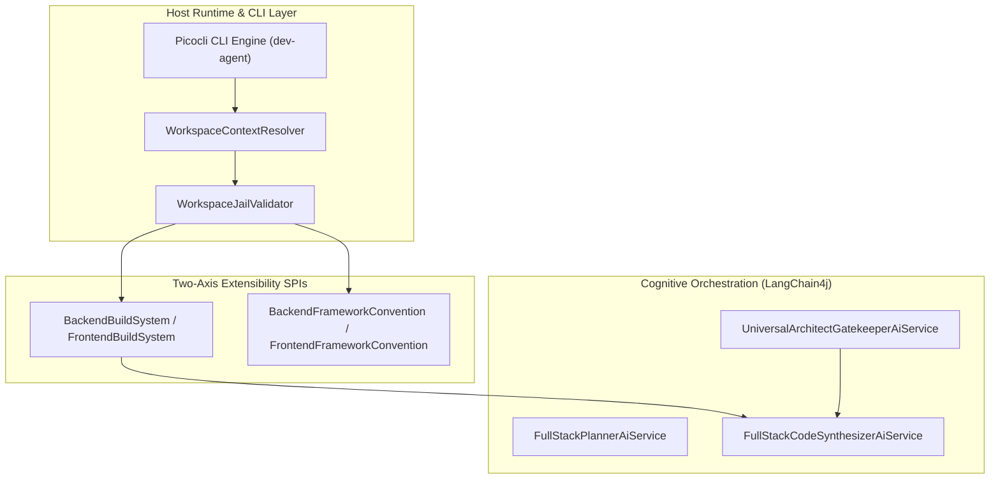
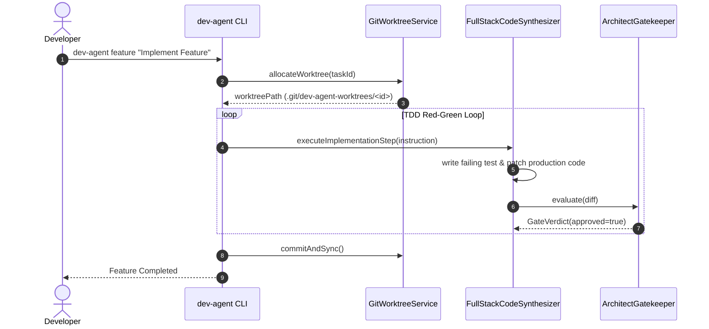
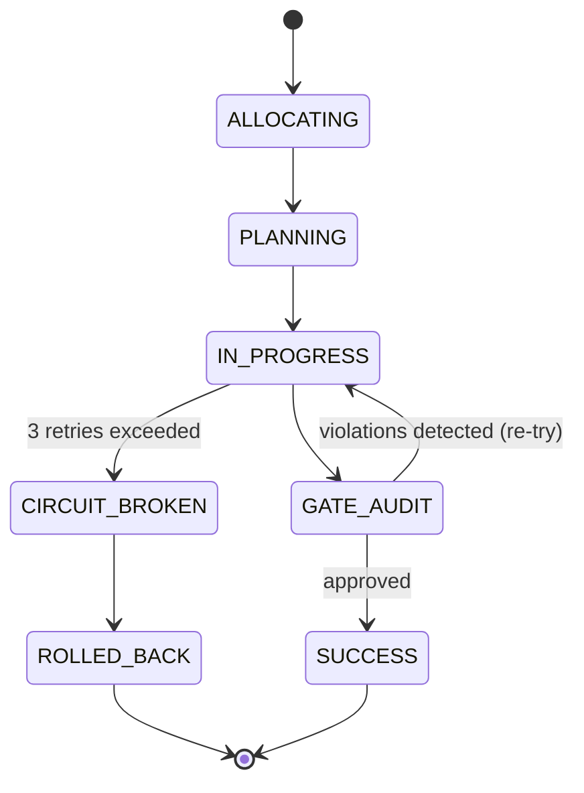

# Mermaid Diagram Templates for dev-agent

Use these clean templates when visualizing architecture, workflows, and state transitions.

## 1. Flowchart / Architecture Topology (`flowchart TD` / `flowchart LR`)

## 2. Sequence Diagram (`sequenceDiagram`)

## 3. State Machine (`stateDiagram-v2`)

