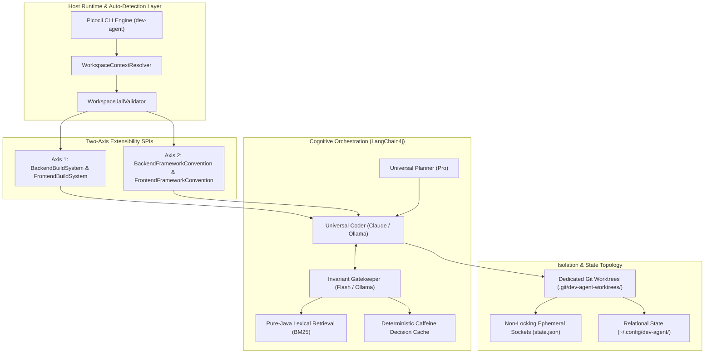

# dev-agent

> **Autonomous Full-Stack Software Engineering CLI & Quality Orchestrator**

`dev-agent` is an autonomous software engineering CLI, pair programmer, and quality orchestrator built on **Quarkus 3.40.x**, **Picocli**, and **Quarkus-LangChain4j**.

The system operates as an **independent developer infrastructure tool**, compiled via GraalVM/Mandrel into a globally installed native executable (`~/.local/bin/dev-agent`) with sub-50ms cold boot times. It is completely decoupled from any single product or repository domain. Any target repository serves purely as an execution workspace governed by declarative configuration and architectural knowledge located in `./.agents/`.

---

## Architecture Topology



---

## Core Invariants

1. **Engine vs. Knowledge Separation:** The CLI binary contains zero hardcoded project domain rules or framework paths. Target repositories provide declarative guidelines in `.agents/rules/` and ADRs in `docs/adr/`.
2. **Two-Axis Open-Closed Principle:** Decouples build tooling (`BackendBuildSystem`, `FrontendBuildSystem`) from framework idioms (`BackendFrameworkConvention`, `FrontendFrameworkConvention`).
3. **Workspace Path Jail & Sandboxing:** `WorkspaceJailValidator` strictly enforces canonical boundaries (`toRealPath()`). Path traversals outside the execution root immediately throw `SecurityException`.
4. **Physical Git Worktree Concurrency:** Background executions run inside `.git/dev-agent-worktrees/<task-id>/` with sliced build targets (`target-agent/`), keeping the developer's primary workspace untouched and unpolluted.
5. **Zero-JNI Native Image Safety:** Semantic retrieval uses a pure-Java lexical BM25 inverted index, eliminating native C++ ONNX JNI compilation traps in GraalVM.
6. **Non-Locking State Sockets:** Active tasks emit atomic `state.json` heartbeats in their worktrees, preventing H2 database lock collisions during foreground CLI status queries.

---

## CLI Command Reference

```bash
# Initialize declarative .agents/ configuration in target workspace
dev-agent init

# Analyze requirements and generate a phased implementation DAG
dev-agent plan "Add OpenTelemetry metrics endpoint"

# Execute full-stack TDD implementation in an isolated worktree
dev-agent feature "Implement user profile API"

# View active task status via non-locking state.json sockets
dev-agent status

# Stream execution logs and audit traces
dev-agent logs <task-id>

# Resume an interrupted task run
dev-agent resume <task-id>
```

---

## Local Development & Fast Verification Loops

Fast feedback commands for autonomous agents and contributors:

```bash
# Fast Unit Tests (< 10s)
./mvnw test -Dtest=*Test

# ArchUnit Native Compliance & Path Jail Verification (< 15s)
./mvnw test -Dtest=AgentArchitectureTest,WorkspaceJailValidatorTest

# Full Clean Build & Verification (< 30s)
./mvnw clean verify

# Auto-Format Code
./mvnw spotless:apply

# SonarCloud Quality Gate Analysis
./mvnw sonar:sonar -Dsonar.qualitygate.wait=true
```

---

## Documentation & ADR Register

* [AGENTS.md](file:///home/developer/projects/dev-agent/AGENTS.md) — Mandatory autonomous agent directives, TDD protocol, and local feedback loops.
* [PROJECT_CONTEXT.md](file:///home/developer/projects/dev-agent/PROJECT_CONTEXT.md) — Master architecture context and implementation blueprint.
* [docs/adr/](file:///home/developer/projects/dev-agent/docs/adr/) — Architecture Decision Records register (ADR-001 through ADR-010).
* [.agents/](file:///home/developer/projects/dev-agent/.agents/) — Declarative configuration, boundary rules, and specialized persona skills.
