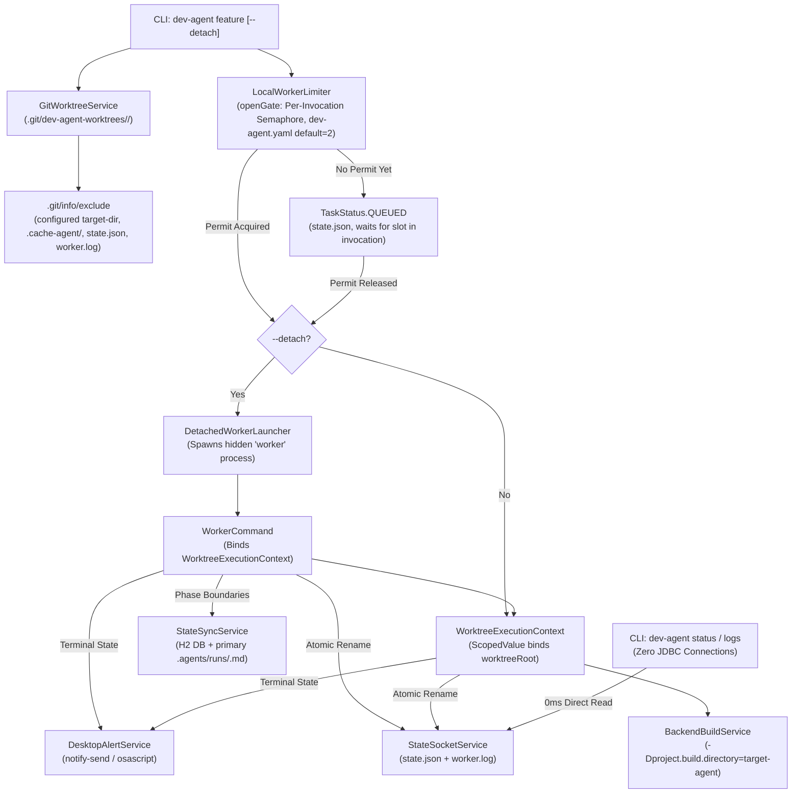
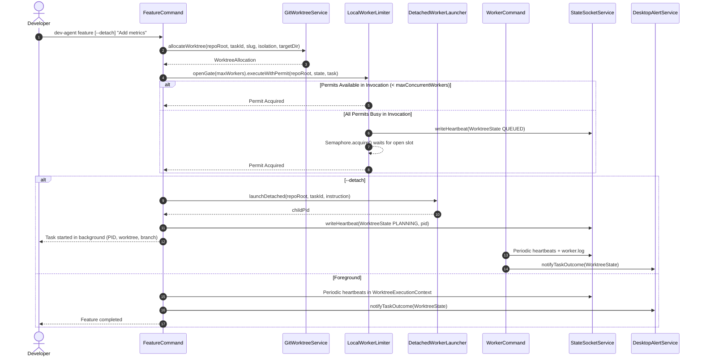

# Cycle 4 Implementation Plan: Async Isolation & Detached Workers

## Goal Description

Implement **Cycle 4 (Async Isolation & Detached Workers)** as specified in [ARCHITECTURE.md](../../ARCHITECTURE.md), transforming the current CLI stubs (`feature`, `status`, `logs`, `abort`, `resume`) and workspace services into a concurrent, non-blocking execution engine.

Specifically, Cycle 4 delivers:
1. **Dedicated Git Worktrees (`GitWorktreeService`)**: Isolated checkouts under `.git/dev-agent-worktrees/<task-id>/` on dedicated branches (`feature/{task-id}-{story-slug}`), automatic working-tree hydration (`git stash create` + `git stash apply`), checkpoint/rollback, worktree pruning, and `WorktreeExecutionContext` separation between primary `repoRoot` and active `executionRoot`.
2. **Maven Build Target Slicing (`target-agent/`) & `.git/info/exclude` Governance**: Automatic `.git/info/exclude` injection for the configured `target-dir` (`target-agent/`), `.cache-agent/`, `state.json`, and `worker.log`, plus config-driven `target-dir` and active worktree-root propagation across `BackendBuildService` and `WorkspaceContextResolver`.
3. **Non-Locking `state.json` Heartbeats & Telemetry CLI (`StateSocketService`)**: Atomic JSON heartbeat sockets inside each worktree read directly with 0 ms lock overhead by `status` and `logs` without opening JDBC H2 connections ([ADR-006](../../docs/adr/ADR-006-non-locking-state-sockets.md)). Includes live/follow log tailing (`logs -f`) and clean process/worktree termination (`abort`).
4. **In-Invocation Worker Concurrency Gate (`LocalWorkerLimiter`) & Detached Workers**: Per-CLI-invocation concurrency gate capped at `maxConcurrentWorkers = 2` (configurable via `agent.max-concurrent-workers` in `.agents/dev-agent.yaml`), queuing excess concurrent tasks in `TaskStatus.QUEUED` until a slot opens within that invocation, plus detached OS worker execution (`DetachedWorkerLauncher` + hidden `WorkerCommand`).
5. **Desktop Alerts (`DesktopAlertService`)**: Cross-platform, zero-JNI, native-image-safe OS notifications (`notify-send`, `osascript`, PowerShell toast) routed through `SubprocessExecutor` with secret redaction and headless/CI graceful no-op.



---

## User Review Required

> [!IMPORTANT]
> **Strict Zero-JDBC Boundary for `status` and `logs` ([ADR-006](../../docs/adr/ADR-006-non-locking-state-sockets.md)):**
> `StatusCommand` and `LogsCommand` must inject `StateSocketService` (pure filesystem JSON + Jackson) and **must never** inject `TaskPersistenceService`, `StateSyncService`, or any JPA/Panache bean. An ArchUnit rule (`areAssignableTo`) will enforce this invariant. For `status --all`, historical runs will be read from `.agents/runs/*.md` journals via `MarkdownParserService` so even `--all` remains 100% lock-free. *(Note: Quarkus `quarkus.hibernate-orm.schema-management.strategy=update` in `application.properties` remains active for `TaskPersistenceService`-using commands; Cycle 6 native cold-boot hardening will evaluate lazy datasource initialization.)*

> [!IMPORTANT]
> **Primary `repoRoot` vs. Active `executionRoot` (`WorktreeExecutionContext`):**
> In a Git worktree (`.git/dev-agent-worktrees/<task-id>/`), `.git` exists as a regular pointer file rather than a directory. Calling `WorkspaceContextResolver.resolveRepoRoot()` naively inside a worktree would misidentify the worktree as the primary repository root—misrouting `.agents/runs/<taskId>.md` and nested `.git/dev-agent-worktrees/` paths. `WorkspaceContextResolver` will therefore distinguish `resolveRepoRoot()` (primary repo root where `.git` is a directory or resolved past worktrees) from `resolveExecutionRoot()` (governed by Java 25 `ScopedValue`-based `WorktreeExecutionContext` for `@ApplicationScoped` tools like `BackendBuildService` and `BackendBuildTool`).

> [!IMPORTANT]
> **Hidden `worker` Subcommand for Detached OS Processes:**
> To support both GraalVM native binaries (`~/.local/bin/dev-agent`) and JVM invocations (`java -jar ...`) without polluting `dev-agent --help` output (verified by `DevAgentIT.testRootHelp`), detached background workers will invoke a hidden Picocli subcommand (`@Command(name = "worker", hidden = true)`).

> [!NOTE]
> **Confirmed Design Decisions:**
> 1. **Per-Invocation Concurrency Limit (`LocalWorkerLimiter`):** The worker limit applies strictly within a single CLI invocation via an invocation-scoped `PermitGate` (`Semaphore`) initialized from `agent.max-concurrent-workers` in `.agents/dev-agent.yaml` (default `2`), keeping the `@ApplicationScoped` bean stateless across invocations and tests.
> 2. **Branch Preservation on `abort`:** `dev-agent abort <taskId>` preserves the `feature/{task-id}-...` Git branch by default and only deletes it when `--delete-branch` is explicitly passed.
> 3. **Foreground Worktree Isolation:** Foreground `dev-agent feature` runs execute inside an isolated Git worktree whenever `agent.isolation.use-worktrees=true` (falling back gracefully when the target directory is not a Git repository).

---

## Proposed Changes

### Component 1: Domain Models, Configuration & ArchUnit Governance

Define immutable, reflection-registered domain models for `state.json` sockets, status JSON output, and worktree allocations, add `TaskStatus.QUEUED`, expose `max-concurrent-workers` and `notifications` config in `.agents/dev-agent.yaml`, and enforce ADR-006 at the ArchUnit level.

#### [MODIFY] [TaskStatus.java](../../src/main/java/guru/thomasweber/devagent/model/TaskStatus.java)
Add `QUEUED` as a non-terminal lifecycle state (before `PLANNING`):
```java
@RegisterForReflection
public enum TaskStatus {
    QUEUED,
    PLANNING,
    RED_TEST,
    GREEN_PATCH,
    VERIFYING,
    CI_POLLING,
    COMPLETED,
    FAILED,
    ABORTED;

    public boolean isTerminal() {
        return this == COMPLETED || this == FAILED || this == ABORTED;
    }
}
```

#### [NEW] `src/main/java/guru/thomasweber/devagent/model/WorktreeState.java`
Immutable record serialized to/from `.git/dev-agent-worktrees/<task-id>/state.json` (`@RegisterForReflection` and `@Builder(toBuilder = true)` per ArchUnit rules):
```java
package guru.thomasweber.devagent.model;

import io.quarkus.runtime.annotations.RegisterForReflection;
import lombok.Builder;

import java.math.BigDecimal;
import java.time.Instant;

@RegisterForReflection
@Builder(toBuilder = true)
public record WorktreeState(
    String taskId,
    String projectId,
    TaskStatus status,
    String phase,
    long tokens,
    BigDecimal cost,
    Long pid,
    String branch,
    String worktreePath,
    Instant startedAt,
    Instant updatedAt,
    String lastMessage
) {
    public WorktreeState {
        if (cost == null) {
            cost = BigDecimal.ZERO;
        }
    }
}
```

#### [NEW] `src/main/java/guru/thomasweber/devagent/model/WorktreeAllocation.java`
Immutable record (`@RegisterForReflection`, `@Builder(toBuilder = true)`) returned by `GitWorktreeService`:
- Fields: `String taskId`, `String branch`, `Path worktreePath`, `String baseCommit`, `String checkpointStash`, `boolean hydrated`.

#### [NEW] `src/main/java/guru/thomasweber/devagent/model/StatusPayload.java`
Immutable record (`@RegisterForReflection`) for `dev-agent status --json` so Jackson serialization works cleanly in GraalVM Mandrel native builds:
- Fields: `List<WorktreeState> activeTasks`, `String message` (compact constructor ensures `activeTasks` defaults to `List.of()` when null).

#### [MODIFY] [DevAgentConfig.java](../../src/main/java/guru/thomasweber/devagent/config/DevAgentConfig.java)
Add `maxConcurrentWorkers()` at root (`agent.max-concurrent-workers`, default `2`) and `NotificationsConfig` (`agent.notifications`), ensuring every method has `@WithDefault` so empty `.agents/dev-agent.yaml` loading never fails:
```java
@WithDefault("2")
@WithName("max-concurrent-workers")
int maxConcurrentWorkers();

NotificationsConfig notifications();

interface NotificationsConfig {
    @WithDefault("true")
    @WithName("desktop-enabled")
    boolean desktopEnabled();

    @WithDefault("true")
    @WithName("on-success")
    boolean onSuccess();

    @WithDefault("true")
    @WithName("on-failure")
    boolean onFailure();
}
```

#### [MODIFY] [InitCommand.java](../../src/main/java/guru/thomasweber/devagent/cli/InitCommand.java)
Include `max-concurrent-workers: 2` in the generated `.agents/dev-agent.yaml` template under `agent:` so users can discover and adjust the concurrency limit directly in `dev-agent.yaml`.

#### [MODIFY] [AgentArchitectureTest.java](../../src/test/java/guru/thomasweber/devagent/AgentArchitectureTest.java)
Add an ArchUnit invariant guaranteeing ADR-006 using valid ArchUnit `areAssignableTo` syntax:
```java
@ArchTest
public static final ArchRule statusAndLogsCommandsMustNotAccessPersistenceOrJpa =
    noClasses()
        .that().areAssignableTo(StatusCommand.class)
        .or().areAssignableTo(LogsCommand.class)
        .should().dependOnClassesThat().resideInAnyPackage(
            "guru.thomasweber.devagent.entity..",
            "jakarta.persistence..",
            "javax.sql.."
        )
        .as("StatusCommand and LogsCommand must read state.json without opening JDBC/JPA connections (ADR-006)");
```

---

### Component 2: Git Worktree Lifecycle, Execution Context & Target Build Slicing

Implement isolated Git worktree provisioning, ephemeral stash hydration, `.git/info/exclude` automation, `ScopedValue`-backed active worktree binding, and worktree-aware Maven build slicing (`target-agent/`).

#### [NEW] `src/main/java/guru/thomasweber/devagent/workspace/WorkspaceException.java`
Strongly-typed domain exception (per [02-coding-standards.md](../../.agents/rules/02-coding-standards.md)) for Git worktree, exclude-file, and detached launcher failures (`WorkspaceException(String message)` and `WorkspaceException(String message, Throwable cause)`).

#### [NEW] `src/main/java/guru/thomasweber/devagent/workspace/WorktreeExecutionContext.java`
Java 25 `ScopedValue`-backed execution context isolating the **active execution root** (worktree path) from the **primary repository root**:
```java
package guru.thomasweber.devagent.workspace;

import java.nio.file.Path;
import java.util.Optional;
import java.util.concurrent.Callable;

public final class WorktreeExecutionContext {
    private static final ScopedValue<Path> ACTIVE_WORKTREE_ROOT = ScopedValue.newInstance();

    private WorktreeExecutionContext() {}

    public static Optional<Path> currentWorktreeRoot() {
        return ACTIVE_WORKTREE_ROOT.isBound() ? Optional.of(ACTIVE_WORKTREE_ROOT.get()) : Optional.empty();
    }

    public static <T> T runInWorktree(Path worktreeRoot, Callable<T> action) throws Exception {
        return ScopedValue.where(ACTIVE_WORKTREE_ROOT, worktreeRoot).call(action);
    }
}
```
This allows `@ApplicationScoped` tools (`BackendBuildService`, `BackendBuildTool`) to execute builds and jail checks inside `.git/dev-agent-worktrees/<task-id>/` without mutating singleton state or misrouting `.agents/runs/` projections.

#### [NEW] `src/main/java/guru/thomasweber/devagent/workspace/GitExcludeManager.java`
`@ApplicationScoped` service ensuring `.git/info/exclude` (resolved under the primary `.git` directory, or skipped gracefully if not a Git repository) idempotently contains:
- Configured `targetDir + "/"` (from `DevAgentConfig.build().backend().targetDir()`, defaulting to `target-agent/`)
- `.cache-agent/`
- `state.json`
- `worker.log`

Validates against symlinks (`Files.isSymbolicLink`) on `.git`, `.git/info`, and `.git/info/exclude` before writing (preserving the `.git/**` protection in `RepoPath` for LLM-facing write tools while letting the engine manage Git excludes safely).

#### [NEW] `src/main/java/guru/thomasweber/devagent/workspace/GitWorktreeService.java`
`@ApplicationScoped` service delegating all Git commands to `SubprocessExecutor` with explicit timeouts (`Duration.ofSeconds(30)`):
- **`allocateWorktree(Path repoRoot, String taskId, String storySlug, DevAgentConfig.IsolationConfig isolation, String targetDir)`**:
  1. Validates `taskId` (rejects null/blank/`..`/`/`/`\`, throwing `SecurityException`).
  2. Ensures `.git/info/exclude` entries via `GitExcludeManager`.
  3. Resolves worktree target `.git/dev-agent-worktrees/<taskId>/` and checks ancestor paths for symlinks (`Files.isSymbolicLink`).
  4. Renders branch name from `isolation.branchTemplate()` (default `feature/{task-id}-{story-slug}`), normalizing slug to lowercase alphanumeric + hyphens (`<= 48` chars).
  5. Captures `baseCommit` (`git rev-parse HEAD`).
  6. Creates worktree: `git worktree add -b <branch> <worktreePath> <baseCommit>` (or attaches existing branch if resuming: `git worktree add <worktreePath> <branch>`).
  7. If `isolation.autoStashUncommitted()` is true and `git status --porcelain` is non-empty in `repoRoot`: runs `git stash create` in `repoRoot` and, if non-blank SHA returned, executes `git stash apply <stashSha>` inside `worktreePath`, recording `checkpointStash`.
  8. Returns `WorktreeAllocation`.
- **`isGitRepository(Path dir)`**: checks `git rev-parse --is-inside-work-tree` via `SubprocessExecutor` so non-Git workspaces fall back gracefully.
- **`commitChanges(Path worktreePath, String message)`**: stages non-excluded files (`git add -A`) and commits if staged changes exist.
- **`resetToBase(Path worktreePath, String baseCommit)`**: executes `git reset --hard <baseCommit>` + `git clean -fd -e state.json -e worker.log -e target-agent -e .cache-agent`.
- **`removeWorktree(Path repoRoot, String taskId, boolean deleteBranch, String branchName)`**: executes `git worktree remove --force <worktreePath>`, `git worktree prune`, cleans residual directory if needed, and deletes `<branchName>` via `git branch -D` only when `deleteBranch == true`.
- **`listWorktreeTaskIds(Path repoRoot)`**: scans `.git/dev-agent-worktrees/` safely.

#### [MODIFY] [WorkspaceContextResolver.java](../../src/main/java/guru/thomasweber/devagent/workspace/WorkspaceContextResolver.java)
- Update `resolveRepoRoot()` so if `workingDir` lies inside `.git/dev-agent-worktrees/<task-id>/` (where `.git` is a regular file rather than a directory), traversal continues upward to the primary repository root (where `.git` is a directory) so `.agents/runs/` and `.git/dev-agent-worktrees/` never nest inside a worktree.
- Add `resolveExecutionRoot()` returning `WorktreeExecutionContext.currentWorktreeRoot().orElseGet(this::resolveRepoRoot)`.
- Add `resolveAgentCacheDir()` returning `resolveExecutionRoot().resolve(".cache-agent")`.
- Add `resolveWorktreesRoot()` returning `resolveRepoRoot().resolve(".git").resolve("dev-agent-worktrees")`.
- Update `getJailValidator()` to anchor `WorkspaceJailValidator` on `resolveExecutionRoot()` so write tools operate safely inside the active worktree when bound.

#### [MODIFY] [BackendBuildService.java](../../src/main/java/guru/thomasweber/devagent/workspace/BackendBuildService.java)
- Inject `DevAgentConfigLoader` and `GitExcludeManager` (keeping backward-compatible constructor overload for existing tests).
- Resolve `effectiveRoot` via `contextResolver.resolveExecutionRoot()` in `compile(String)` and `test(String, String)` so builds inside `WorktreeExecutionContext` automatically target the isolated worktree.
- Resolve `target-dir` from `.agents/dev-agent.yaml` via `DevAgentConfigLoader` (defaulting to `target-agent`).
- Call `gitExcludeManager.ensureExcluded(contextResolver.resolveRepoRoot(), effectiveTarget)` before running `compile(...)` or `test(...)` when inside a Git repository, guaranteeing `target-agent/` and `.cache-agent/` never dirty `git status`.

---

### Component 3: Non-Locking `state.json` Heartbeats & Sync Integration

Provide zero-JDBC atomic `state.json` reads/writes and decouple socket telemetry from Hibernate/Panache persistence.

#### [NEW] `src/main/java/guru/thomasweber/devagent/workspace/StateSocketService.java`
`@ApplicationScoped` service depending **only** on `ObjectMapper` (Jackson with `JavaTimeModule`), `SecretRedactionFilter`, and `WorkspaceContextResolver` (no `TaskPersistenceService`, no JPA; provides fallback constructor initializing `ObjectMapper` with `JavaTimeModule` and `SerializationFeature.WRITE_DATES_AS_TIMESTAMPS = false`):
- `resolveStateFile(Path repoRoot, String taskId)` -> `.git/dev-agent-worktrees/<taskId>/state.json` (validates `taskId` against `..`, `/`, `\`, null/blank, and checks for symlinks per CWE-59).
- `resolveWorkerLogFile(Path repoRoot, String taskId)` -> `.git/dev-agent-worktrees/<taskId>/worker.log` (with symlink validation).
- `writeHeartbeat(Path repoRoot, WorktreeState state)`:
  - Redacts `state.lastMessage()` via `SecretRedactionFilter`.
  - Serializes `WorktreeState` to JSON and writes to a sibling temporary file (`state.json.tmp`) in the worktree directory, then atomically moves via `Files.move(tmp, target, StandardCopyOption.ATOMIC_MOVE, StandardCopyOption.REPLACE_EXISTING)` (with `REPLACE_EXISTING` fallback if `AtomicMoveNotSupportedException`).
- `readState(Path repoRoot, String taskId)` -> `Optional<WorktreeState>` (returns `Optional.empty()` if missing or malformed, logging warning).
- `readAllStates(Path repoRoot)` -> `List<WorktreeState>` sorted by `updatedAt` descending (0 ms filesystem read across `.git/dev-agent-worktrees/*/state.json`).
- `isProcessAlive(WorktreeState state)` -> checks `state.pid() != null && ProcessHandle.of(state.pid()).isPresent()`.

#### [MODIFY] [StateSyncService.java](../../src/main/java/guru/thomasweber/devagent/workspace/StateSyncService.java)
Inject optional `StateSocketService` (preserving existing constructors for unit tests). When `projectToMarkdown(TaskRun)` runs and a worktree directory exists for `taskRun.taskId()`, mirror the transition into `state.json` via `StateSocketService.writeHeartbeat(...)` so H2 phase transitions and `state.json` stay aligned.

---

### Component 4: In-Invocation Concurrency Gate, Detached Workers & CLI Commands

Enforce the configurable `max-concurrent-workers` limit (`2` by default) within a single CLI invocation, spawn detached workers, and wire `feature`, `status`, `logs`, `abort`, and `resume`.



#### [NEW] `src/main/java/guru/thomasweber/devagent/workspace/LocalWorkerLimiter.java`
`@ApplicationScoped`, stateless concurrency gate factory backed by `StateSocketService` and `DevAgentConfigLoader`:
- Exposes `PermitGate openGate(int maxConcurrentWorkers)` and `PermitGate openGateForWorkspace(Path repoRoot)` (reading `agent.max-concurrent-workers` from `.agents/dev-agent.yaml`, defaulting to `2` and enforcing `>= 1`).
- **`PermitGate`** (public static nested class wrapping `Semaphore` and `AtomicInteger queuedCount` for one CLI invocation):
  - **`<T> T executeWithPermit(Path repoRoot, WorktreeState candidateState, Callable<T> work)`**:
    1. Attempts non-blocking `semaphore.tryAcquire()`.
    2. If unavailable: increments `queuedCount`, writes `candidateState` with `TaskStatus.QUEUED` via `StateSocketService.writeHeartbeat(...)`, and blocks on `semaphore.acquire()`, decrementing `queuedCount` once acquired.
    3. Executes `work.call()` and releases the permit strictly in `finally`.
  - **`<T> List<T> executeBatch(Path repoRoot, List<QueuedTask<T>> tasks)`**: executes multiple tasks concurrently via virtual threads (`Executors.newVirtualThreadPerTaskExecutor()`) bounded by the invocation's `PermitGate`.
  - Exposes `maxPermits()`, `availablePermits()`, and `queuedCount()` for telemetry and black-box verification without reflection.

#### [NEW] `src/main/java/guru/thomasweber/devagent/workspace/DetachedWorkerLauncher.java`
`@ApplicationScoped` process launcher:
- Resolves current executable command cleanly via `ProcessHandle.current().info()` (handles both Mandrel native binary `<binary> --dir <root> worker --task-id <id>` and JVM `java -cp <classpath> ...` or `-jar <jar>` fallback).
- Redirects stdout and stderr via `ProcessBuilder.Redirect.appendTo(workerLogFile)` and stdin via `ProcessBuilder.Redirect.DISCARD`.
- Starts detached child process and returns child `pid`. (Does **not** use `SubprocessExecutor` because `SubprocessExecutor` blocks until termination/timeout, whereas detached workers intentionally outlive the parent CLI process.)

#### [NEW] `src/main/java/guru/thomasweber/devagent/cli/WorkerCommand.java`
`@Dependent @Unremovable @Command(name = "worker", hidden = true)` implementing `Callable<Integer>`:
- Options: `--task-id`, `--instruction`.
- Binds `WorktreeExecutionContext.runInWorktree(worktreePath, ...)` so builds/jail checks run inside the allocated worktree directory, updates `state.json` heartbeats (`PLANNING` -> `VERIFYING` -> `COMPLETED`/`FAILED`), executes `BackendBuildService` compilation/verification when an applicable build system exists, persists major lifecycle transitions via `StateSyncService` / `TaskPersistenceService`, and emits `DesktopAlertService` notification on terminal state.

#### [MODIFY] [DevAgentCommand.java](../../src/main/java/guru/thomasweber/devagent/DevAgentCommand.java)
Register `WorkerCommand.class` in `@Command(subcommands = { ... })` (hidden from `--help` output).

#### [MODIFY] [FeatureCommand.java](../../src/main/java/guru/thomasweber/devagent/cli/FeatureCommand.java)
Implement `Callable<Integer>` with `@Inject` constructor + no-arg fallback constructor:
- Preserves existing output banner (`[dev-agent] Initiating full-stack TDD execution: <instruction>`) and blank-instruction warning.
- Loads `DevAgentConfig` from `.agents/dev-agent.yaml` via `DevAgentConfigLoader` (`isolation.useWorktrees()`, `maxConcurrentWorkers()`, `build.backend().targetDir()`).
- Generates task ID (e.g., `TASK-<shortHash/timestamp>`) and resolves `ProjectId`.
- When inside a Git repo (`gitWorktreeService.isGitRepository(repoRoot)`) and (`config.isolation().useWorktrees()` or `--detach`): allocates an isolated worktree via `GitWorktreeService` and writes initial `WorktreeState`. When not in a Git repo (e.g., plain temp dirs), skips Git worktree allocation gracefully and exits `0` cleanly.
- Guards execution through `LocalWorkerLimiter.openGate(config.maxConcurrentWorkers()).executeWithPermit(...)`:
  - If `--detach`: spawns `WorkerCommand` via `DetachedWorkerLauncher`, writes `pid` to `state.json` and `TaskRun`, and prints task ID, branch, worktree path, and PID.
  - If foreground: binds `WorktreeExecutionContext.runInWorktree(...)`, emits `state.json` heartbeats, runs `BackendBuildService` verification if a build system is present, and notifies via `DesktopAlertService` on completion.

#### [MODIFY] [ResumeCommand.java](../../src/main/java/guru/thomasweber/devagent/cli/ResumeCommand.java)
Wire `DetachedWorkerLauncher` (with `--detach` option or foreground resume inside `WorktreeExecutionContext`) so confirmed/explicit `resume <taskId>` re-attaches the worker to the existing worktree and updates `pid` in both `state.json` and `TaskRun` (preserving existing test contracts when launcher/worktree is mocked or non-detached).

#### [MODIFY] [StatusCommand.java](../../src/main/java/guru/thomasweber/devagent/cli/StatusCommand.java)
Inject `StateSocketService` and `MarkdownParserService` (zero JDBC!):
- Preserves `[dev-agent] Checking active task sockets...` and `[dev-agent] No active background tasks detected.` (and exact JSON `{"activeTasks":[],"message":"No active background tasks detected."}`) when no active tasks exist.
- Reads active `state.json` sockets via `StateSocketService.readAllStates(workspaceRoot)`.
- Annotates each task with live PID status (`RUNNING`, `STALE/CRASHED`, `QUEUED`, or terminal status).
- With `--all`: also parses `.agents/runs/*.md` historical journals for tasks no longer in `.git/dev-agent-worktrees/`.
- With `--json`: serializes `StatusPayload` via Jackson `ObjectMapper` when tasks exist.

#### [MODIFY] [LogsCommand.java](../../src/main/java/guru/thomasweber/devagent/cli/LogsCommand.java)
Inject `StateSocketService` (zero JDBC!):
- Preserves `[dev-agent] Streaming logs for task: <taskId>` header and missing-taskId prompt.
- Validates `taskId` against path traversal.
- Reads `.git/dev-agent-worktrees/<taskId>/worker.log` (falling back to `.agents/runs/<taskId>.md` if worktree was already pruned).
- With `-f` / `--follow`: tails newly appended lines using `SeekableByteChannel` / file offset polling (200 ms interval) until `StateSocketService.readState` reports a terminal status and PID has exited (or thread interrupted).

#### [MODIFY] [AbortCommand.java](../../src/main/java/guru/thomasweber/devagent/cli/AbortCommand.java)
Inject `StateSocketService`, `GitWorktreeService`, and `TaskPersistenceService`, adding `@Option(names = {"--delete-branch"}, description = "Delete the task feature branch after unlinking the worktree") boolean deleteBranch`:
- Preserves `[dev-agent] Aborting background task: <taskId>` output and missing-taskId prompt.
- Validates `taskId` against traversal.
- Reads `state.json` (and `TaskPersistenceService` if needed) to find `pid` and `branch`.
- Terminates live process via `ProcessHandle.of(pid)` (`destroy()`, waiting briefly, then `destroyForcibly()`).
- Updates `state.json` and `TaskRun` to `TaskStatus.ABORTED`, removes worktree via `GitWorktreeService.removeWorktree(repoRoot, taskId, deleteBranch, branch)` (preserving the branch by default unless `--delete-branch` is set).

---

### Component 5: Cross-Platform Desktop Alerts

#### [NEW] `src/main/java/guru/thomasweber/devagent/workspace/DesktopAlertService.java`
`@ApplicationScoped` service using `SubprocessExecutor` (zero AWT/JNI for GraalVM Mandrel native compatibility):
- Injects `SubprocessExecutor`, `SecretRedactionFilter`, and `DevAgentConfigLoader`.
- `void notifyTaskOutcome(Path repoRoot, WorktreeState state)`:
  1. Checks `DevAgentConfig.notifications().desktopEnabled()` and `onSuccess`/`onFailure` flags.
  2. Checks environment availability (on Linux: `DISPLAY`, `WAYLAND_DISPLAY`, or `DBUS_SESSION_BUS_ADDRESS`; skips silently in headless CI environments).
  3. Redacts title and body via `SecretRedactionFilter`.
  4. Dispatches OS-specific non-blocking command with short timeout (`Duration.ofSeconds(3)`):
     - **Linux**: `["notify-send", "--app-name=dev-agent", "--urgency=" + urgency, sanitizedTitle, sanitizedBody]`
     - **macOS**: `["osascript", "-e", "display notification \"" + escapeAppleScript(sanitizedBody) + "\" with title \"" + escapeAppleScript(sanitizedTitle) + "\""]`
     - **Windows**: `["powershell", "-NoProfile", "-Command", ...]` (with strict single-quote escaping)
  5. Swallows missing executable or non-zero exit codes at `DEBUG` log level so desktop alert failures never break task completion.

---

### Component 6: Canonical Test Fixtures & Multi-Tier Verification

All tests adhere strictly to [05-testing-standards.md](../../.agents/rules/05-testing-standards.md): zero reflection (`setAccessible`), zero synthetic production seams, AssertJ assertions exclusively, `@DisplayName("Given ... - when ... - then ...")`, and 1-to-1 `*Test.java` coverage.

#### [NEW] `src/test/java/guru/thomasweber/devagent/testutil/WorktreeStateMother.java`
Object Mother factory supplying canonical `WorktreeState` fixtures (`active(...)`, `queued(...)`, `crashed(...)`, `completed(...)`) so tests avoid repetitive inline builder plumbing, paired with `WorktreeStateMotherTest.java`.

#### [NEW] Level 1 Unit Tests (`*Test.java`, 1-to-1 per new class)
- `WorktreeStateTest.java`, `WorktreeAllocationTest.java`, `StatusPayloadTest.java`, `WorkspaceExceptionTest.java`
- `WorktreeExecutionContextTest.java` (binding/unbinding `ScopedValue`, nested scopes, fallback when unbound)
- `GitExcludeManagerTest.java`, `GitWorktreeServiceTest.java` (using real temporary Git repos initialized under `@TempDir` as well as mocked `SubprocessExecutor` failure/timeout paths, symlink rejection)
- `StateSocketServiceTest.java` (atomic write, secret redaction, symlink rejection, concurrent read/write, malformed JSON recovery, PID liveness)
- `LocalWorkerLimiterTest.java` (stateless `PermitGate` gating with configurable `maxConcurrentWorkers` from `dev-agent.yaml`, `QUEUED` state transition while waiting, `finally` permit release on exception, concurrent virtual-thread batch execution)
- `DetachedWorkerLauncherTest.java`, `WorkerCommandTest.java`
- `DesktopAlertServiceTest.java` (Linux/macOS/Windows command synthesis via OS property/mocked `SubprocessExecutor`, headless skip, AppleScript escaping, secret redaction, config toggle)
- Updated unit tests: `TaskStatusTest.java`, `DevAgentConfigLoaderTest.java`, `InitCommandTest.java`, `WorkspaceContextResolverTest.java`, `BackendBuildServiceTest.java`, `StateSyncServiceTest.java`, `FeatureCommandTest.java`, `StatusCommandTest.java`, `LogsCommandTest.java`, `AbortCommandTest.java`, `ResumeCommandTest.java`

#### [NEW] Level 2 & Level 3 Integration Tests (`*IT.java`)
- `GitWorktreeIntegrationIT.java`: Real `git init` in `@TempDir`, dirty uncommitted file hydration via `git stash create` + `git stash apply`, `target-agent/` exclusion verification (`git status --porcelain` stays clean), primary `repoRoot` vs `WorktreeExecutionContext` resolution check, worktree removal & pruning (preserving branch by default, deleting with `--delete-branch`).
- `DetachedWorkerIT.java`: End-to-end `QuarkusMainTest` verifying detached worker launch, `state.json` heartbeat telemetry via `dev-agent status --json`, `dev-agent logs`, `dev-agent abort`, and single-invocation `LocalWorkerLimiter` concurrency throttling (`max-concurrent-workers: 2`).
- Update `NativeDevAgentIT.java`: Assert Mandrel native binary cold start `< 50 ms` for `status` and `logs`, and verify `@RegisterForReflection` JSON deserialization of `WorktreeState` and `StatusPayload` in native mode.

---

### Component 7: Documentation & Agent Harness Updates

Synchronize repository documentation, ADRs, and the autonomous agent harness (`AGENTS.md`, `.agents/rules/`, `.agents/skills/`, `.agents/templates/`) with Cycle 4 architecture and finalized design decisions.

#### Part A: Repository & Architecture Documentation

##### [MODIFY] [ARCHITECTURE.md](../../ARCHITECTURE.md)
- **Section 6 (`Concurrency & Host Resource Guardrails (LocalWorkerLimiter)`)**: Update `LocalWorkerLimiter` specification to reflect the **per-CLI-invocation** `PermitGate` (`Semaphore`) configured via `agent.max-concurrent-workers` in `.agents/dev-agent.yaml` (default `2`), and document `WorktreeExecutionContext` (`ScopedValue` primary vs. active worktree root separation).
- **Section 7 (`Complete Schema Specification (.agents/dev-agent.yaml)`)**: Document root `agent.max-concurrent-workers: 2` and `agent.notifications` (`desktop-enabled`, `on-success`, `on-failure`).
- **Section 10 (`ArchUnit Architecture Governance Rules`)**: Add `statusAndLogsCommandsMustNotAccessPersistenceOrJpa` (`areAssignableTo(StatusCommand.class)` / `LogsCommand.class`) enforcing ADR-006.
- **Section 10 (`Evolutionary Walking Skeleton Roadmap`)**: Mark **Cycle 4 (`Async Isolation & Detached Workers`)** validation status as `DONE` upon completion and full gate verification.

##### [MODIFY] [README.md](../../README.md)
- **CLI Command Reference**: Document `dev-agent feature [--detach]`, `dev-agent status [--all] [--json]`, `dev-agent logs [-f|--follow] <task-id>`, and `dev-agent abort [--delete-branch] <task-id>`.
- **Documentation & ADR Register**: Update the ADR range summary from `ADR-001 through ADR-010` to `ADR-001 through ADR-013`.

##### [MODIFY] [PROJECT_CONTEXT.md](../../PROJECT_CONTEXT.md)
- **Section 2 (`Package Layout & Boundary Rules`)**:
  - Under `cli/`: document `AbortCommand` and hidden `WorkerCommand`.
  - Under `workspace/`: document `GitWorktreeService`, `GitExcludeManager`, `WorktreeExecutionContext`, `StateSocketService`, `LocalWorkerLimiter`, `DetachedWorkerLauncher`, `DesktopAlertService`, and `WorkspaceException`.
  - Under `model/`: document `WorktreeState`, `WorktreeAllocation`, and `StatusPayload`.
- **Critical Boundary Constraints**: Document the ADR-006 ArchUnit zero-JDBC rule (`StatusCommand` and `LogsCommand`) and `WorktreeExecutionContext` primary-vs-worktree root isolation.

##### [MODIFY] [ADR-004-git-worktree-isolation.md](../../docs/adr/ADR-004-git-worktree-isolation.md) & [ADR-006-non-locking-state-sockets.md](../../docs/adr/ADR-006-non-locking-state-sockets.md)
- **ADR-004**: Document automated `.git/info/exclude` injection (`target-agent/`, `.cache-agent/`, `state.json`, `worker.log`), branch preservation by default on `abort` (`--delete-branch` opt-in), and `WorktreeExecutionContext` (`ScopedValue`) isolation.
- **ADR-006**: Document the `WorktreeState` JSON contract in `state.json`, `worker.log` tailing (`logs -f`), and compile/ArchUnit enforcement (`statusAndLogsCommandsMustNotAccessPersistenceOrJpa`).

#### Part B: Autonomous Agent Harness (`AGENTS.md` & `.agents/`)

##### [MODIFY] [AGENTS.md](../../AGENTS.md)
- **Section 4 (`Autonomous Agent Directives`)**:
  - Update **Directive 3 (`Workspace Concurrency & Physical Isolation`)**: document `WorktreeExecutionContext` separation between primary `repoRoot` and active worktree `executionRoot`, `.git/info/exclude` governance (`target-agent/`, `.cache-agent/`, `state.json`, `worker.log`), and branch preservation on `abort` unless `--delete-branch` is passed.
  - Update **Directive 6 (`Non-Locking Ephemeral State Sockets`)**: document `StateSocketService` zero-JDBC isolation enforced via ArchUnit and `worker.log` streaming.
  - Clarify **Directive 14 (`Subprocess Lifetime & Timeout Governance`)**: note that `DetachedWorkerLauncher` intentionally spawns out-of-process detached background workers (via hidden `WorkerCommand`) that outlive the parent CLI process and redirect output to `worker.log`, while all synchronous external commands (`git`, `mvnw`, `notify-send`, `osascript`, PowerShell) MUST execute through `SubprocessExecutor`.
  - Document the per-invocation `LocalWorkerLimiter` (`agent.max-concurrent-workers`, default `2`).

##### [MODIFY] [01-architecture-invariants.md](../../.agents/rules/01-architecture-invariants.md)
- **Section 4 (`Worktree Concurrency & Build Slicing`)**: add `state.json` and `worker.log` to `.git/info/exclude` invariants and document `WorktreeExecutionContext` primary-vs-worktree root separation.
- **Section 6 (`Non-Locking Ephemeral State Sockets`)**: add ArchUnit enforcement (`StatusCommand` and `LogsCommand` must not depend on `entity`, `jakarta.persistence`, or `javax.sql`).

##### [MODIFY] [03-quality-and-slas.md](../../.agents/rules/03-quality-and-slas.md)
- **Section 1 (`Boot Timing & Resource Guardrails`)**: clarify that `maxConcurrentWorkers = 2` (configured via `agent.max-concurrent-workers` in `.agents/dev-agent.yaml`) bounds concurrent worker execution **per CLI invocation** via `LocalWorkerLimiter.PermitGate`, with waiting tasks entering `TaskStatus.QUEUED`. Note that desktop notifications (`DesktopAlertService`) use zero-AWT/zero-JNI `SubprocessExecutor` commands and silently no-op in headless/CI environments.

##### [MODIFY] [05-testing-standards.md](../../.agents/rules/05-testing-standards.md)
- **Section 2.4 (`Canonical Test Data Builders & Object Mother Pattern`)**: register `WorktreeStateMother` alongside `TaskRunMother`, `StepAuditMother`, and `WorktreeTestFixture`.
- **Section 3 (`Subsystem Boundary Testing Standards`)**: add a **Worktree Isolation, State Sockets & Desktop Alerts** subsection covering atomic `state.json` writes, `WorktreeExecutionContext` scope cleanup, real `@TempDir` `git init` hydration/exclusion tests, and headless-safe `DesktopAlertService` assertions.

##### [MODIFY] [backend-engineer/SKILL.md](../../.agents/skills/backend-engineer/SKILL.md)
- **Section 1 (`Picocli & CLI Conventions`)**: document hidden `WorkerCommand` (`hidden = true`), `AbortCommand` (`--delete-branch`), and zero-JDBC constraints on `StatusCommand`/`LogsCommand`.
- **Section 2 (`Workspace & Sandboxing Invariants`)**: document `GitWorktreeService`, `GitExcludeManager`, `WorktreeExecutionContext`, `StateSocketService`, `LocalWorkerLimiter`, `DetachedWorkerLauncher`, and `DesktopAlertService`.
- **Section 4 (`Test Engineering & Fixture Invariants`)**: add `WorktreeStateMother`.

##### [MODIFY] [lead-architect/SKILL.md](../../.agents/skills/lead-architect/SKILL.md)
- **Section 2 (`ArchUnit Native Compliance Rules`)**: add Rule 6 (`Zero-JDBC Telemetry`: `StatusCommand` and `LogsCommand` must not depend on `entity`, `jakarta.persistence`, or `javax.sql`).

##### [MODIFY] [test-engineer/SKILL.md](../../.agents/skills/test-engineer/SKILL.md) & [test-manager/SKILL.md](../../.agents/skills/test-manager/SKILL.md)
- Update `test-engineer/SKILL.md` Section 2 (`ArchUnit Native Compliance Rules`) with `statusAndLogsCommandsMustNotAccessPersistenceOrJpa` and Section 5 with `WorktreeStateMother`.
- Update `test-manager/SKILL.md` Section 3 (`Canonical Fixtures`) with `WorktreeStateMother`.

##### [MODIFY] [mermaid-templates.md](../../.agents/templates/mermaid-templates.md) & Verify [config.json](../../.agents/config.json)
- Update the `sequenceDiagram` template in `mermaid-templates.md` to include `LocalWorkerLimiter`, `StateSocketService`, and `DesktopAlertService` in the worktree lifecycle flow.
- Confirm `.agents/config.json` `qualityGoalsAndSLA.maxConcurrentWorkers` (`2`) remains aligned with `DevAgentConfig` defaults.

---

## Verification Plan

### Automated Tests
Execute strictly in order following the Spotless-First and 3-phase TDD protocol:

1. **Auto-Format Code (Always First):**
   ```bash
   ./mvnw spotless:apply
   ```
2. **Compile, ArchUnit & Fast Unit Tests ($< 15\text{ s}$):**
   ```bash
   ./mvnw test -Dtest=*Test
   ```
3. **Architecture & Boundary Governance:**
   ```bash
   ./mvnw test -Dtest=AgentArchitectureTest,WorkspaceJailValidatorTest
   ```
4. **JaCoCo Coverage & Quality Gates (Line $\ge 95.0\%$, Branch $\ge 90.0\%$):**
   ```bash
   ./scripts/parse_jacoco.py --fail-under-gates
   ```
5. **Import Hygiene & Markdown Link Checks:**
   ```bash
   python3 scripts/verify_import_hygiene.py
   python3 scripts/verify_markdown_links.py
   ```
6. **Full Clean Build & Integration Verification:**
   ```bash
   ./mvnw clean verify
   ```
7. **Native Mandrel Binary Verification (L3 Cold Boot $< 50\text{ ms}$):**
   ```bash
   ./mvnw verify -Pnative
   ```

### Manual Verification
1. Run `dev-agent feature --detach "Add health check metric"` in a sample Maven/Quarkus repository with uncommitted edits in the primary working tree; verify `git status` in the main workspace remains untouched while the uncommitted edits appear in `.git/dev-agent-worktrees/<task-id>/`.
2. Run `dev-agent status` and `dev-agent logs -f <taskId>` while the worker compiles into `target-agent/`; confirm zero H2 lock errors and verify `git status` inside the worktree ignores `target-agent/`, `.cache-agent/`, `state.json`, and `worker.log`.
3. Configure `agent.max-concurrent-workers: 2` in `.agents/dev-agent.yaml` and dispatch 3 concurrent tasks within a single invocation; confirm 2 run concurrently while the 3rd transitions to `QUEUED` until a slot opens.
4. Run `dev-agent abort <taskId>` and confirm the worktree is removed while the `feature/...` branch is preserved; re-verify `--delete-branch` removes the branch when explicitly requested.
5. Trigger completion on a desktop session (`DISPLAY` or macOS) and verify an OS desktop notification appears without exposing any credentials.
