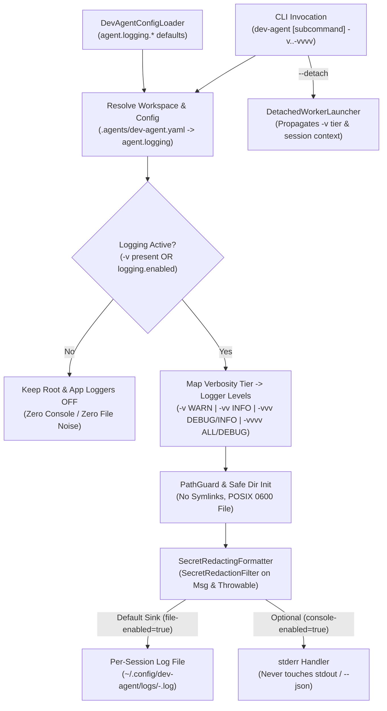

# Cycle 4.5 Implementation Plan: Opt-In Per-Session Logging & Redacted Diagnostics

> **Status:** **DONE** (Implemented via strict TDD on `feature/TASK-010-cycle45-logging-plan`)

## Goal Description

Implement **Cycle 4.5 (Opt-In Per-Session Logging & Redacted Diagnostics)** as a focused pre-Cycle-5 observability foundation specified in [ARCHITECTURE.md](../../ARCHITECTURE.md). Normal CLI executions remain silent on framework and diagnostic logs by default—keeping terminal UI and `--json` outputs clean—while enabling structured, secret-scrubbed file-first diagnostics whenever opted in via `-v`..`-vvvv` (`--verbose`) or `.agents/dev-agent.yaml`.

Specifically, Cycle 4.5 delivers:
1. **Opt-In Runtime Activation with AOT-Safe Compile-Time Floor (`application.properties`)**: Keep `quarkus.log.level=OFF`, `quarkus.log.console.enable=false`, and `quarkus.log.file.enable=false` by default while setting build-time `quarkus.log.min-level=ALL` so GraalVM Mandrel native binaries ([ADR-001](../../docs/adr/ADR-001-quarkus-picocli-native-cli.md)) preserve `DEBUG`/`ALL` log call sites for runtime activation.
2. **4-Tier Inheritable CLI Verbosity (`-v` .. `-vvvv`)**: Replace the unused boolean `--verbose` field on `DevAgentCommand` with a repeatable `ScopeType.INHERIT` flag (`-v`/`--verbose`) honoring exact category scoping across both foreground commands and detached `worker` subprocesses.
3. **Per-Session Log Files as Default Sink (`SessionLoggingService`)**: When logging is enabled via CLI flags or `.agents/dev-agent.yaml` (`agent.logging.enabled=true`), route logs by default to a dedicated per-session file (`~/.config/dev-agent/logs/<yyyyMMdd-HHmmss>-<sessionId>.log`, configurable via `agent.logging.dir`), with bounded file retention and optional `stderr` mirroring (`agent.logging.console-enabled`). `stdout` is strictly never used for framework or debug logs.
4. **Context-Aware Secret Redaction at the Log Boundary ([ADR-008](../../docs/adr/ADR-008-context-aware-secret-redaction.md))**: Format and filter every emitted log record and exception message through `SecretRedactionFilter` before flushing to disk or `stderr`, preventing credential leaks under `-vvv` / `-vvvv`.



---

## Verbosity Tiers & Category Scoping

CLI `-v` flags always override `.agents/dev-agent.yaml` settings (`agent.logging.enabled` and `agent.logging.level`). Repeated `-v` / `--verbose` occurrences map deterministically:

| Invocation / Config | `guru.thomasweber.devagent` Level | Root Logger (3rd-Party Frameworks) | Effective Levels Captured |
| :--- | :--- | :--- | :--- |
| Default (no `-v`, `enabled: false`) | `OFF` | `OFF` | None (silent diagnostic logging) |
| `-v` (count = 1) or `level: WARN` | `WARN` | `WARN` | `ERROR`, `WARN` |
| `-vv` (count = 2) or `level: INFO` | `INFO` | `INFO` | `ERROR`, `WARN`, `INFO` |
| `-vvv` (count = 3) or `level: DEBUG` | `DEBUG` | `INFO` | `dev-agent`: `ERROR`, `WARN`, `INFO`, `DEBUG`<br>3rd-party (Quarkus/Hibernate/Netty/LangChain4j): `ERROR`, `WARN`, `INFO` |
| `-vvvv` (count $\ge 4$) or `level: ALL` | `ALL` | `DEBUG` | `dev-agent`: all levels (`TRACE`/`ALL`+)<br>3rd-party: `ERROR`, `WARN`, `INFO`, `DEBUG` |

> [!IMPORTANT]
> **CLI Subcommand Inheritance (`ScopeType.INHERIT`):**
> `-v` / `--verbose` MUST be declared with `scope = ScopeType.INHERIT` (or inherited via `BaseAgentCommand`) so both `dev-agent -vvv feature "..."` and `dev-agent feature -vvv "..."` parse identically.
> **JSON & Stdout Purity:** Console logging (`console-enabled: true`) MUST exclusively target `stderr` so commands such as `dev-agent status --json` and `dev-agent metrics --json` never emit non-JSON bytes on `stdout`.

---

## Configuration Specification (`.agents/dev-agent.yaml`)

Extend `DevAgentConfig` (`@ConfigMapping(prefix = "agent")`) with a strongly-typed `LoggingConfig logging()` interface:

```yaml
agent:
  logging:
    enabled: false                    # Opt-in toggle (overridden to true when any -v flag is passed)
    level: WARN                       # WARN | INFO | DEBUG | ALL (overridden by -v..-vvvv count)
    file-enabled: true                # File logging is the default sink whenever logging is active
    console-enabled: false            # Optional stderr mirroring for live terminal diagnostics
    dir: "~/.config/dev-agent/logs"   # Session log directory (supports workspace-relative or absolute paths)
    max-files: 50                     # Bounded retention keeping the newest N session log files
```

### Configuration Rules & Precedence
1. **CLI Override:** Passing `-v`..`-vvvv` enables logging even when `agent.logging.enabled` is `false` and sets the exact tier (`1`=`WARN`, `2`=`INFO`, `3`=`DEBUG`, `4+`=`ALL`). Passing zero `-v` flags falls back to `agent.logging.enabled` and `agent.logging.level`.
2. **Sinks when Active:** With `file-enabled: true` (default), each CLI execution creates a unique per-session file `<logDir>/<yyyyMMdd-HHmmss>-<sessionId>.log`. Setting `file-enabled: false` and `console-enabled: true` allows `stderr`-only diagnostics when explicitly configured.
3. **Detached Worker Propagation:** When launching a background worker (`DetachedWorkerLauncher`), preserve the caller's active `-v` tier (or YAML opt-in) on the child `worker` invocation so both the task's `worker.log` and the worker's dedicated per-session log record matching diagnostics, including parent `SessionId` and `TaskId` correlation metadata.

---

## Security & Architectural Guardrails

1. **Zero-JDBC Boundary Preserved ([ADR-006](../../docs/adr/ADR-006-non-locking-state-sockets.md)):** `SessionLoggingService` and Picocli execution hooks MUST remain strictly decoupled from `..entity..`, `jakarta.persistence..`, and `javax.sql..` so `StatusCommand` and `LogsCommand` continue passing `AgentArchitectureTest`.
2. **Secret Redaction Quarantine ([ADR-008](../../docs/adr/ADR-008-context-aware-secret-redaction.md)):** Every log line emitted through `SecretRedactingFormatter` (message text, formatted arguments, and exception `Throwable` messages/causes) passes through `SecretRedactionFilter` before hitting disk or `stderr`. Application code must still avoid logging raw source file contents or credentials.
3. **Symlink & Path Traversal Protection ([ADR-003](../../docs/adr/ADR-003-workspace-path-jail.md)):** Before opening the session log file, validate the resolved log directory and target file path with `PathGuard` (rejecting symlinks and ensuring workspace-relative `agent.logging.dir` values stay inside the workspace root, while allowing user home state `~/.config/dev-agent/logs` explicitly). Set restrictive POSIX file permissions (`0600` owner read/write, `0700` dir where supported).
4. **Native AOT & JBoss LogManager Safety ([ADR-001](../../docs/adr/ADR-001-quarkus-picocli-native-cli.md)):** Configure loggers programmatically via JBoss LogManager (`org.jboss.logmanager.LogContext` / `Logger` / `FileHandler` / `ConsoleHandler`) without reflection-heavy XML configuration or dynamic classloading. Ensure active file handlers are flushed and closed in a `finally` block (including uncaught exception paths) so logs are never truncated on short-lived CLI invocations.
5. **Hermetic Test Isolation:** Unit tests inject/override log directory paths via `@TempDir` and clean up handlers in `@AfterEach`, never creating artifacts inside the developer's `~/.config/dev-agent/logs/`.

---

## Proposed File Changes

| Component | Target File | Responsibility |
| :--- | :--- | :--- |
| **Runtime & AOT Defaults** | `src/main/resources/application.properties` | Set `quarkus.log.min-level=ALL`, `quarkus.log.level=OFF`, `quarkus.log.console.enable=false`, `quarkus.log.console.stderr=true`, `quarkus.log.file.enable=false`. |
| **Config Mapping** | `src/main/java/guru/thomasweber/devagent/config/DevAgentConfig.java` | Add nested `LoggingConfig` (`enabled`, `level`, `fileEnabled`, `consoleEnabled`, `dir`, `maxFiles`). |
| **Verbosity Value Object** | `src/main/java/guru/thomasweber/devagent/model/LogVerbosity.java` | Strongly-typed `@RegisterForReflection` enum mapping `-v` count / YAML strings to (`devAgentLevel`, `rootLevel`) pairs (`OFF`, `WARN`, `INFO`, `DEBUG`, `ALL`). |
| **Redacting Formatter** | `src/main/java/guru/thomasweber/devagent/logging/SecretRedactingFormatter.java` | Extends `org.jboss.logmanager.ExtFormatter`; formats timestamp, level, logger, thread, message, stack trace and scrubs via `SecretRedactionFilter`. |
| **Session Log Lifecycle** | `src/main/java/guru/thomasweber/devagent/logging/SessionLoggingService.java` | Generates/resolves `SessionId`, validates log dir via `PathGuard`, opens per-session `FileHandler` (plus optional `stderr` `ConsoleHandler`), enforces `max-files` pruning, sets JBoss `Logger` levels, and closes cleanly via `AutoCloseable`. |
| **CLI Integration** | `src/main/java/guru/thomasweber/devagent/DevAgentCommand.java` & `BaseAgentCommand.java` | Replace boolean `verbose` with repeatable `ScopeType.INHERIT` `-v`/`--verbose`; expose `getVerbosityCount()` helper and Picocli `IExecutionStrategy` wiring (supporting Quarkus `QuarkusMain` execution). |
| **Detached Worker Propagation** | `src/main/java/guru/thomasweber/devagent/workspace/DetachedWorkerLauncher.java` & `FeatureCommand.java` | Pass caller `-v` tier flags (when active) into `buildWorkerCommand(...)` so detached workers preserve diagnostic verbosity. |
| **Call-Site Audit** | `cli/`, `cognitive/`, `workspace/`, `entity/` | Add concise structured `LOG.debugf` / `LOG.tracef` / `LOG.infof` diagnostics across command lifecycle, worktree allocation, subprocess execution, BM25 retrieval, cache hits, and gatekeeper verdicts. |

---

## Verification Plan (Strict TDD & Quality Gates)

1. **RED-GREEN-REFACTOR Unit Tests (`*Test.java`):**
   - `LogVerbosityTest`: verifies `0..5` `-v` counts, case-insensitive YAML level parsing, invalid level rejection, and exact `(devAgentLevel, rootLevel)` pairs (`-vvv` -> `DEBUG`/`INFO`, `-vvvv` -> `ALL`/`DEBUG`).
   - `SecretRedactingFormatterTest`: verifies Bearer tokens, PATs, API keys, and credentialed URLs inside both log messages and thrown exceptions are redacted while preserving readable diagnostics.
   - `SessionLoggingServiceTest`: uses `@TempDir` to verify default-OFF behavior, opt-in via CLI `-v` overriding `enabled: false`, opt-in via `dev-agent.yaml`, unique per-session log filenames across sequential invocations, `file-enabled` vs `console-enabled` (`stderr` only), symlink directory rejection (`SecurityException`), `max-files` retention pruning, and deterministic handler closure.
   - `DevAgentConfigLoaderTest`: verifies `agent.logging.*` defaults and YAML overrides.
   - `DetachedWorkerLauncherTest` & `DevAgentCommandTest`: verifies inherited `-v` parsing before/after subcommands (`dev-agent status -vvv` and `dev-agent -vvv status`) and `-v` propagation into `worker` commands.
2. **ArchUnit & Gate Verification:**
   - `./mvnw -q spotless:apply`
   - `./mvnw -q clean verify` (Surefire unit coverage + Failsafe integration tests)
   - `./scripts/parse_jacoco.py --threshold 95.0 --fail-under-gates` (Line $\ge 95.0\%$, Branch $\ge 90.0\%$)
   - `python3 scripts/verify_import_hygiene.py && python3 scripts/verify_markdown_links.py`
   - Mandrel native binary smoke check confirming `--verbose` / `-vvvv` emits `DEBUG`/`TRACE` records when enabled and produces zero framework stdout when disabled.
